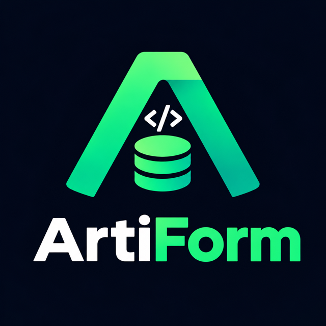

<p align="center">
  
</p>

Config-as-code for JFrog Artifactory: describe your
Artifactory **projects**, their **repositories**, **members** (users and
LDAP groups with project roles) and **package cleanup policies** in one YAML
file in Git, and let a CI pipeline reconcile Artifactory against it.

## What it manages

| Section | Artifactory API | Notes |
|---|---|---|
| `projects` | `/access/api/v1/projects` | create, update, enforce-delete |
| `repositories` | `/artifactory/api/repositories` + project attach | per project, any repo type/field, sharing across projects |
| `members` | `/access/api/v1/projects/{key}/users\|groups` | roles per user/group, LDAP group import |
| `cleanup_policies` | `/artifactory/api/cleanup/packages/policies` | project-scoped package cleanup |

Requirements: Artifactory self-hosted 7.x with a license that includes
Projects. Package cleanup policies additionally require Artifactory >= 7.98.7
with an Enterprise X or Enterprise+ license.

## Quick start

```yaml
# artiform.yml
config_version: 1

artifactory:
  url: https://artifactory.example.com   # token comes from ARTIFACTORY_TOKEN

projects:
  team-x:
    display_name: "Team X"
    repositories:
      enforce: true
      generate:                  # team-x-<tech>-<maturity>-local per combination
        package_types: [maven, npm, helmoci, docker]
        maturities: [dev, prod]
    members:
      enforce: true
      groups:
        team-x-developers:
          import_from_ldap: corporate-ldap-groups
          roles: [Developer]
    cleanup_policies:
      enforce: true
      docker-30d:
        cron_exp: "0 0 1 * * ?"
        search_criteria:
          package_types: [docker]
          repos: [team-x-docker-dev-local]
          included_packages: ["**"]
          last_downloaded_before_in_days: 30
```

```
export ARTIFACTORY_TOKEN=...   # platform admin access token
artiform --dry-run            # review, then run without --dry-run
```

## Documentation

- [Running ArtiForm](docs/running.md) - CLI, authentication, exit codes,
  the GitLab CI pipeline (dry-run on merge requests, apply on the default
  branch)
- [Configuration file](docs/configuration.md) - structure, defaults,
  environment variables (`$VAR`), one file per team
- [Enforce (deletions)](docs/enforce.md) - authoritative mode and its safety
  guards
- [Changelog](docs/changelog.md), [Contributing](CONTRIBUTING.md),
  [Development](docs/contrib/development.md) (tests, linting, git hooks) and
  [Releases](docs/contrib/releases.md) (container image on `ghcr.io`)
- Reference: [projects](docs/reference/projects.md),
  [repositories](docs/reference/repositories.md) (incl. generators and
  sharing with other projects), [members](docs/reference/members.md),
  [cleanup policies](docs/reference/cleanup_policies.md)

Complete examples: [examples/artiform.yml](examples/artiform.yml)
(single file) and [examples/multi-team](examples/multi-team) (one file per
team plus a platform-owned `shared` project).

## License

[MIT](LICENSE).

## Development

```
pip install -e . --group dev
pytest
pre-commit install          # ruff, mypy, bandit and codespell on every commit
```

See [Contributing](CONTRIBUTING.md) and
[Development](docs/contrib/development.md).
